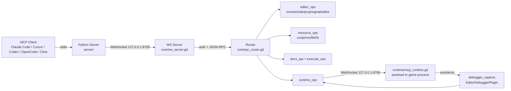
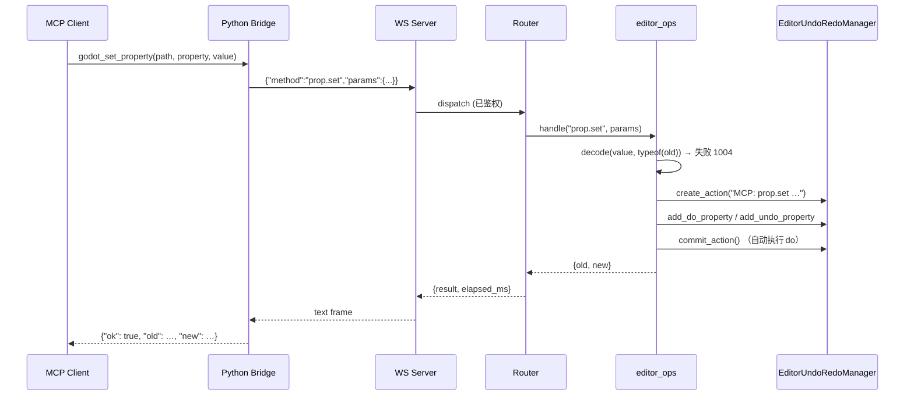

# 架构说明 / Architecture

## 进程与链路

## 端口与发现

| 项 | 值 |
|---|---|
| 编辑器端口 | `8765` 起，冲突时 +1 递增（最多 20 次） |
| 运行时端口 | 编辑器端口 + 1，同样递增 |
| 握手文件 | `<project>/.godot/mcp_bridge.json` |
| 发现顺序 | 显式参数 → 环境变量 → 向上查找握手文件 → 扫描 `8765–8784` |

握手文件字段：`schema / protocol / port / runtime_port / token / pid / project_path /
project_name / godot_version / started_at`。

## 一次写调用的生命周期

失败路径：参数/类型/路径错误在 `commit_action()` 前返回，场景保持原状；协议层错误带
`code / message / hint / context / trace`。

## 值编解码

- 原生 JSON（null/bool/int/float/string/array/dict）原样通过。
- Godot 类型编码为 `{"__gd":"Vector2","x":1,"y":2}`。
- 解码接受 `__gd` 精确形式、`"Vector2(1, 2)"`、`"(1, 2)"`、`"1,2"`、`[1,2]`、
  `"#ff0000"`、`"red"`、数字/布尔字符串。
- **不可解析即失败（1004）**，绝不静默变为 0。
- 对象引用只记录 `class + path`，不递归节点/资源图；深度上限 32。

## 运行时桥

1. 插件启用时注册 autoload `McpRuntime`（仅当项目未定义；禁用时若由插件添加则移除）。
2. 游戏进程启动后读取握手文件，作为 WebSocket 客户端连接 `runtime_port`，首帧 `auth`。
3. 编辑器侧把 `runtime.*` 请求转发给游戏；游戏侧执行后回包。
4. 编辑器主线程同步等待（数据 3s、截图 5s、eval 8s、run 20s），超时返回 `1010`。
5. 截图：`get_viewport().get_texture().get_image()` → 降采样 → PNG → base64。
6. 输入：`Input.parse_input_event`、`Input.action_press/release`，按序 `await` 帧与延时。

## 文件职责

| 文件 | 职责 |
|---|---|
| `plugin.gd` | 生命周期、设置、UI 装配、autoload、`_process` 轮询 |
| `core/ws_server.gd` | TCP/WS 多客户端、鉴权、空闲回收、日志环 |
| `core/rpc_router.gd` | 方法表、system 方法、legacy 映射、模块工厂 |
| `core/value_codec.gd` | 17 类值双向编解码 |
| `core/editor_ops.gd` | 场景/节点/属性/信号/编辑器操作 + undo |
| `core/resource_ops.gd` | 脚本/资源/文件/搜索 + 路径越界校验 |
| `core/execute_ops.gd` | GDScript 片段执行（`@tool` 包装、结果编码） |
| `core/runtime_ops.gd` | 运行时端口服务、请求泵、日志合并 |
| `core/debugger_capture.gd` | 捕获游戏 print/error |
| `runtime/mcp_runtime.gd` | 游戏进程内 RPC 服务端、截图/输入/eval |
| `ui/dock_panel.gd` | 状态、端口、token、客户端配置、日志 |

## 安全边界

- 仅监听 `127.0.0.1`；默认 token 鉴权，失败 `close(4001)`。
- 文件路径仅允许 `res://`、`user://`，且简化后必须仍在项目内；越界 `1005`。
- 不执行来自网络的任意系统命令；`execute.gdscript` 在临时节点内运行且随场景销毁。
- 手柄/输入模拟只作用于游戏进程，不影响编辑器。
